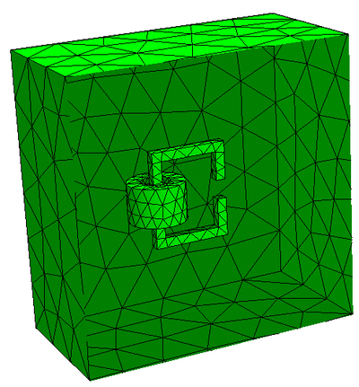
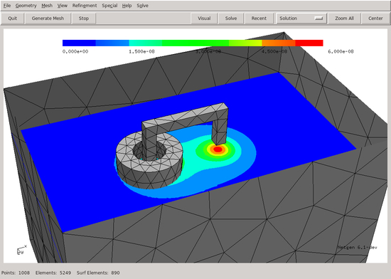

:orphan:

.. _whetting-cmagnet:

Symbolic definition of forms : magnetic field
=============================================

.. note::

   This page shows the classic Python-script version of this example.
   The current, interactive version is the i-tutorial :doc:`Maxwell equations </i-tutorials/wta/maxwell>`.

We compute the magnetic field generated by a coil placed on a
C-core. We see how to

* model a 3D geometry by boolean operations of solids
* set material properties from domain and boundary labels
* write down the variational equation symbolically using trial- and testfunctions

Download  :download:`cmagnet.py</../py_tutorials/cmagnet.py>`

.. literalinclude:: /../py_tutorials/cmagnet.py

Mesh and magnitude of magnetic field visualized in Netgen:

